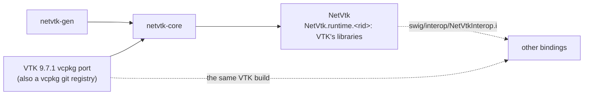

# NetVtk plan

Goal: free, MIT, generated C# bindings for current VTK. They're the base for simulation visualization in .NET (fields on meshes, isosurfaces, cuts, glyphs, streamlines, volume rendering, result readers), and other bindings can build on their proxies. No maintained open-source .NET binding of VTK exists: Kitware's ActiViz is proprietary and licensed per version, and its last open-source release is 5.8.

## Repositories and packages

- **NetVtk** wraps VTK's classes with their names unchanged; its runtime packages hold VTK's libraries and their dependencies.
- **Other bindings** can derive their classes from NetVtk's proxies and pass NetVtk's objects in their signatures, through `NetVtkInterop.i`, which the package ships.
- **One VTK build.** A binding compiled against VTK's headers runs VTK's inline code, so it needs NetVtk's VTK. netvtk serves its port as a vcpkg git registry (`versions/` at the root): a project that pins it at a NetVtk release's commit, copies `vcpkg/triplets` and asks for the port's features as `vcpkg.json` does gets the same build, with the same ABI hash.

## Decisions (confirmed 2026-10-11)

| Decision | Choice | Why |
|---|---|---|
| VTK version | 9.7.1 (2026-09-26), own overlay port | vcpkg's port is stuck on 9.3.0 (2023) |
| Module set | about 20 modules first (below) | package size, build time |
| C# namespace | one namespace, `Vtk` | VTK's class names are unique (`vtk` prefix); a pipeline touches six modules or more |
| Target frameworks | net35 to net10.0, netstandard2.0 | old .NET Framework applications too; the typemap library handles CLR 2 |
| Generator | netvtk-gen: a libclang parser, a mapper and a SWIG writer with VTK's rules | VTK's headers say what a binding needs (hints, macros, module properties) |
| Versions | `<VTK version>.<revision>` (`9.7.1.1`) | a version names the VTK it wraps |
| Layout | `netvtk-core`, `-generator`, `-documentation`, `-demos` | each folder builds on its own |

First modules: CommonCore, CommonDataModel, CommonExecutionModel, CommonMath, CommonTransforms, CommonColor, FiltersCore, FiltersGeneral, FiltersGeometry, FiltersSources, FiltersModeling, IOLegacy, IOXML, RenderingCore, RenderingOpenGL2, RenderingAnnotation, RenderingFreeType, RenderingUI, InteractionStyle, InteractionWidgets. The port keeps an empty `opengl` feature, for consumers that ask for `vtk[opengl]`.

## How VTK maps

- **Lifetime** (`VtkObjects.i`): `vtkObjectBase` counts references. The proxy holds one reference, which Dispose and the finalizer drop (`UnRegister`, SWIG's unref; there is no ref feature). `New()` and `NewInstance()` hand over a reference of their own (spelled `T*`); every other returned object gets one from the wrapper (spelled `T* const`). A C# constructor calls `New()` (`%vtk_new`), so the object factory picks the class (`new vtkRenderWindow()` is a `vtkWin32OpenGLRenderWindow`). `vtkSmartPointer<T>`, `vtkNew<T>` and `vtkWeakPointer<T>` map to proxies.
- **Hints:** VTK marks its headers for wrappers (`vtkWrappingHints.h`). netvtk-gen defines `VTK_SIZEHINT`, `VTK_WRAPEXCLUDE`, `VTK_NEWINSTANCE` and the other hints as `annotate` attributes, which libclang reports (`vtk::sizehint(6)` on `vtkDataSet::GetBounds`); not through `__VTK_WRAP__`, which changes what the headers declare. A size hint is a return of `NETVTK_SIZE<N>` (`%netvtk_sized_return`): a C# array copied right after the call. Some hints name parameters (`sizehint(pts, npts)`).
- **Macros:** `vtkSetMacro`, `vtkGetMacro` and `vtkTypeMacro` expand to ordinary members, and libclang sees them expanded.
- **Modules:** a module's headers and dependencies come from VTK's `vtk.module` files and the CMake module properties it installs (check what the install carries).
- **Errors:** VTK reports through `vtkOutputWindow` and error events, not exceptions. They go to C# as an event, with exceptions opt-in.
- **Callbacks:** `vtkCommand` observers are C# subclasses through directors (`Directors.i`); C# events on top come in phase 3. An exception an override throws doesn't unwind through VTK, which isn't written for it: the callback returns, VTK goes on, and the wrapped call that led to it throws a `VtkException` carrying the C# one (NetVtkRuntime holds its number per thread, across the wrapper libraries).
- **Width typedefs:** `vtkIdType` (64-bit ids on every architecture: the port sets `VTK_USE_64BIT_IDS`) and `vtkMTimeType` keep their names in the wrappers, which compile on every platform; C# sees `long` and `ulong`. C `unsigned long` (event ids, observer tags) is a C# `ulong`, range-checked on Windows.
- **Data:** arrays hold fields of millions of values, so they need bulk copies (`ToArray`, `FromArray`), `Span<T>` on .NET Core, and zero-copy where VTK marks it.
- **Templates:** `vtkAOSDataArrayTemplate<T>` and its kin are the bases of `vtkDoubleArray` and the other typed arrays: classes named by their arguments (`vtkAOSDataArrayTemplate_double`). Instances over `long long` are in (VTK's 64-bit types are `long long` on every platform: `vtkIdTypeArray`'s base); over `size_t`, `long` and `wchar_t` out; VTK's third-party templates (`vtknlohmannjson/`) out.

## Phases

### 0. Spike: prove the risky parts

- VTK 9.7.1 overlay port with the module set, built on x64-windows. Record build time, installed size and library count.
- A hand-written SWIG module over about ten classes (`vtkObjectBase`, `vtkObject`, `vtkConeSource`, `vtkPolyDataMapper`, `vtkActor`, `vtkRenderer`, `vtkRenderWindow`, `vtkCommand`, `vtkPolyData`, `vtkDoubleArray`). It proves reference counts (a test reads `GetReferenceCount`), size hints and an observer callback.
- A cone in a WPF and an Avalonia window: VTK's render window as a child of our window (`SetParentId`/`SetWindowId`), with mouse input fed to an interactor.
- libclang reading `[[vtk::sizehint]]` with `__VTK_WRAP__` defined.
- Exit: the numbers, a go or no-go on lifetime and hosting, and the decisions above confirmed.

**Done 2026-10-11; go given the same day.** Results:

| | win-x64 | win-x86 |
|---|---|---|
| VTK 9.7.1 build (vcpkg, release, 20 threads) | 16.6 min first, 18.1 min rebuild | 18.3 min |
| VTK libraries | 68 DLLs, 81 MB | 68 DLLs, 75 MB |
| Staged runtime (VTK + 5 NetVtk libraries), zipped | 20.9 MB | 19.5 MB |
| Spike tests (18), net10.0 and net48 | pass | pass |

- **Port:** no dependency on other ports: VTK's own third-party copies, with mangled symbols. VTK's two executables go to `tools/vtk`, where its CMake targets point (the config fixup rewrites them). Installed headers: 33 MB.
- **Lifetime: go.** Tests read the reference counts: `New()` and the constructor give 1, a returned object 2 (owner and proxy), `Dispose` and the finalizer drop the proxy's reference, an object set on another outlives its proxy, `SafeDownCast` gives the derived proxy or null.
- **Size hints: go.** `GetBounds()` (6), `GetColor()` (3), `GetSize()` (2 ints), `GetRange()` (2) are C# arrays. libclang reports the hints as `annotate` attributes: 7 of `vtkDataSet`'s 83 methods, 29 of `vtkProperty`'s 239.
- **Callbacks: go.** A C# `vtkCommand` is called back with its caller; VTK keeps an observer only it holds alive; an exception in an observer comes out of `Modified()` as a `VtkException` whose InnerException is the C# one, and the next call is clean.
- **Rendering: go.** An offscreen render draws a cone actor, on x64 and x86. The WPF (`HwndHost`) and Avalonia (`NativeControlHost`) viewers draw a cone coloured by a point field into our child window, VTK's `vtkGenericRenderWindowInteractor` fed from our window procedure; the visual check is the user's.
- **The managed assembly** builds for all eight targets, net35 included.
- **For later phases:**
  - `vtkRenderWindow::Finalize()` clashes with C#'s finalizer (CS0465): netvtk-gen leaves it out, logged (phase 2).
  - The finalizer may delete rendering objects on its thread, where no OpenGL context is current: phase 3 decides (release them on their thread, or require Dispose).
  - VTK's `char*` returns (`vtkGetStringMacro`) are declared `const char*`; enums declared through macros (`vtkCommand::EventIds`) need libclang's values.

### 1. netvtk-core foundation

- `build.py` (tools, vcpkg, generate, native, test, pack).
- Typemap library: numbers, strings, streams, arrays, directors, keep-alive, and VTK's lifetimes.
- CMake: one native library per module group (a Windows DLL exports at most 65535 functions), plus `NativeLibraryLoader`.
- Tests on every framework, x64 and x86; Linux and macOS builds.

**Done 2026-10-11.** `build.py` has the commands tools, vtk, generate, native, test, pack, test-package, version, changelog, change and release; `test/test_build.py` (15 tests) checks its rules. The typemap library has `VtkObjects.i` for VTK's lifetimes; ValueTypes.i and Std.i are in, ready for VTK's small value classes. The runtime packages carry `THIRD-PARTY-NOTICES.txt` (124 KB: NetVtk's license and NOTICE, VTK's Copyright.txt and the 49 module and third-party licenses VTK installs). `format.py` and the pinned clang-format pass. Verified:

| | tests (22) | packages |
|---|---|---|
| win-x64 | net10.0, net8.0, net6.0, net48, net472, net462, the net45 and net452 builds, net35 on CLR 2 | NetVtk 275 KB, runtime 23.3 MB; package tests (net8.0, net48) pass |
| win-x86 | the same | runtime 21.6 MB; package tests pass |
| linux-x64 (Docker, Xvfb) | net10.0, net8.0, net6.0 | package test (net8.0) passes; VTK builds in 14 min there |
| osx-arm64 | CI only (phase 5), once pushed | |

### 2. netvtk-gen

- netvtk-gen: parser, mapper, writer and golden tests, with VTK's rules (lifetime, hints, smart pointers, VTK's templates, module discovery).
- Skip logs per module, `generate --check`, deterministic output.
- Generate the first module set, replacing phase 0's hand-written module.

**Done 2026-10-11.** netvtk-gen writes the 20 modules: 2,102 classes, 238 enums, 731 members skipped with a reason (`VTK_WRAPEXCLUDE`'d members aren't logged). `netvtk-generator/CLAUDE.md` lists the rules. Fixes the builds forced: function pointer typedefs by name (`vtkThreadFunctionType` is `__stdcall` on win-x86), VTK's Windows-only headers and `GetClassNameA`/`W` out (Linux). Fixes the skip review found: `long long` instances in (`vtkIdTypeArray`'s typed members), compiler builtins in inline bodies link (`vtkCellArray::GetCellAtId`), VTK's third-party templates out. Verified:

| | |
|---|---|
| netvtk-gen | 180 unit and golden tests pass; the golden fixture is a fake VTK install (`Golden/vtk`) |
| `generate --check` | clean (about a minute) |
| win-x64, win-x86 | SWIG, native, the 23 tests on every framework (net35 on CLR 2) |
| linux-x64 (Docker) | native, the 23 tests on net10.0, net8.0, net6.0, package test |
| format | `format.py --check` clean |

Left for later: `std::vector` parameters and returns (about 100 members, mostly internals), `PrintSelf` (65, a stream VTK might keep: phase 3 gives `ToString`), the `Transient` identifiers in the generator (VTK objects now).

### 3. Data and interop

- Bulk array access and zero-copy views.
- Observers as C# events; `vtkOutputWindow` routed to C#.
- A public native-pointer interop (`NativePointer`, a factory from a pointer) for other bindings and C++/CLI users.
- `protected` pointer constructors on the proxies, so another assembly's proxies can derive from them.
- The SWIG interface files ship with each release, for other bindings.

**Done 2026-10-12.** Proxies are `partial`; hand-written members in `netvtk-core/src/NetVtk/<Module>/` and `extras/CommonCore.i`:

- **Arrays:** the typed arrays (`vtkDoubleArray` and its ten siblings, through their `vtkAOSDataArrayTemplate<T>` base) have `ToArray`, `CopyFrom`, `FromArray`, and on .NET 6+ `AsSpan` (the array's memory) and `CopyFrom(ReadOnlySpan<T>)`; bulk copies go through NetVtkRuntime's `memcpy`, on every .NET. `vtkDataArray.ToDoubleArray()` converts any array.
- **Observers:** `AddObserver(id, handler)`, `Observe` (an `IDisposable`), the events `ModifiedEvent`, `ErrorEvent`, `WarningEvent`, and `StartEvent`, `ProgressEvent`, `EndEvent` on algorithms; `VtkEventArgs` reads the call data (`GetText`, `GetDouble`).
- **Messages:** `VtkOutput` installs a C# `vtkOutputWindow` (a new director): VTK's errors and warnings go to `VtkOutput.Message`, to `Trace` without a handler; no window, no console.
- **Interop:** `NativePointer`, `vtkObjectBase.FromNativePointer<T>(pointer, ownsReference)`; `ToString()` is VTK's `Print`. NetVtk carries its SWIG files in `swig/` (4.2 MB, 0.4 MB packed).
- **Rendering thread:** `VtkFinalizer.Context` makes the finalizer post releases to the thread that renders.
- **Generator:** VTK's width typedefs are spelled by name by value too (a director's `GetMTime` override must return `vtkMTimeType`, `unsigned long` on Linux); directors get no `%vtk_new`.

Verified: 42 tests (41 on the frameworks without `Span`) on every framework, x64 and x86, and on Linux (Docker: net10.0, net8.0, net6.0); package tests on x64, x86 and Linux; netvtk-gen's 181 tests; `generate --check`; `format.py --check`; clang-format 20.1.8 over `src/Native`. Sizes: NetVtk 18.2 MB (eight 11 MB assemblies, one per framework), NetVtk.runtime.win-x64 26.3 MB, win-x86 27.0 MB.

### 4. Viewers and demos

- `netvtk-demos`: WPF and Avalonia hosts (a child window of our own). Linux (X11) and macOS (NSView) come later.
- Demo: read a `.vtu`, colour by a field, scalar bar, cut plane, contour, warp by displacement. Analysis Situs' `asiVisu` shows what a CAE viewer needs; no copies.

**Done 2026-10-12.** Both viewers run on the packed NetVtk (`nuget.config`, `NetVtk.version.props`, AnyCPU with both Windows RIDs). They open a `.vtu` (or legacy `.vtk`) or the sample (`--sample`: a cantilever beam of 1,280 hexahedra, its displacement, bending stress and a temperature), and show it warped by its displacement, coloured by a field (a vector by its magnitude) with a scalar bar, with a cut plane across the longest axis and contours of a scalar field; a toolbar picks the field and switches each. Verified: 11 tests of the viewer library (the sample written and read back, the pipeline's cut, contours and warp, the opener, and the whole scene rendered off the screen, from blue to red); the user looked at both viewers.

### 5. Release infrastructure

- Workflows: build (four RIDs, vcpkg cache with VTK), generator, format, changelog, release, docs.
- Rendering tests without a GPU: Mesa's llvmpipe on the Windows and Linux runners (to verify). Otherwise compile-only.
- nuget.org Trusted Publishing; THIRD-PARTY-NOTICES for VTK and its dependencies; the registry's `versions/` updated with each release.
- Documentation site: getting started, VTK in C#, lifetimes, pipelines, data arrays, hosting.

**Done 2026-10-12.** The workflows (`.github/`): build (four RIDs, VTK from vcpkg's binary cache, pack, package tests, demos and samples, publish), generator, format, changelog, release PR, docs, Dependabot. Rendering tests run on Linux (Xvfb, Mesa's llvmpipe, as in Docker); the Windows and macOS runners leave them out (`build.py test --no-rendering`). The repository is a vcpkg registry (`versions/`, `build.py registry`; build.yml checks it). The documentation site (`netvtk-documentation/`): 16 articles, every example a region of one of 51 sample tests on the packed NetVtk, the READMEs checked against theirs, a class index linking VTK's nightly reference (no 9.x release reference exists). The first release's changelog entry is in `netvtk-core/changes/`. Verified: the samples (51) pass, docfx builds with 0 warnings, `classes.py --check` finds no broken link, the workflows parse as YAML, `build.py test --no-rendering` leaves out the one rendering test (x64, net10.0 and net35), `test_build.py` passes. Not verified: the workflows themselves, which run once pushed.

**First CI run (2026-10-12):** generator, format and docs pass on main and next; the natives jobs on win-x64, win-x86 and linux-x64 build VTK and NetVtk and pass their tests. The macOS natives job built VTK and then failed on `vtkMultiThreaderIDType`, `pthread_t` (a pointer) on macOS where netvtk-gen had spelled Windows' DWORD: its two members are excluded now. The release-PR workflow ran up to opening the pull request, which needs step 3's setting.

**Second CI run (2026-10-12, the squashed Initial commit):** the natives on win-x64, win-x86 and linux-x64 pass. macOS failed on `vtkOpenGLRenderWindow::CreateOverrideAttributes`, which VTK declares off Apple only: excluded in the config now; no other member the modules wrap sits in a platform `#if` of VTK's headers. Verified after regenerating: the tests on every framework, x64 and x86. Not verified: macOS, until the next push.

**Third CI run (2026-10-13, the Initial commit with the fix):** everything passes on main and next. The natives on all four RIDs (macOS: 46 tests on net10.0, net8.0 and net6.0, the rendering ones left out), the `documentation` job, pack (`NetVtk` 31.5 MB with `NetVtk.xml` in all eight frameworks and `VTK-LICENSE.txt`; runtimes win-x64 29.5 MB, win-x86 30.0, linux-x64 69.5, osx-arm64 44.2), the package tests on Windows, Linux and macOS, the demos and samples; publish skipped (no release in CHANGELOG.md yet). `release.yml` didn't run: its path filter sees no diff in a new root commit (run it by hand while main is amended).

**Fourth CI run (2026-10-13, the Initial commit with the documentation brought up to date):** everything passes again on main and next. `release.yml`, run by hand on next, opened [#1](https://github.com/paulbuechner/netvtk/pull/1) "Release NetVtk 9.7.1.1-next.1"; its checks wait for approval (a pull request of github-actions[bot]). The user looked at both viewers again, on this build.

**IntelliSense and diagrams (2026-10-13):** `build.py docs` writes VTK's doc comments as `NetVtk.xml` (netvtk-gen `docs`, with two rules for VTK's layout: the class comment above the include guard, comments on member groups), which pack ships in every framework with `VTK-LICENSE.txt` (license expression `MIT AND BSD-3-Clause`); build.yml makes it in a Windows `documentation` job beside the natives. 1,944 of 2,454 types and 47,815 of 60,921 members get documentation; `NetVtk` grows to 31.5 MB. The site has nine diagrams, netvtk-core's and netvtk-generator's READMEs three, each as SVG with a dark twin (`diagrams.py`). Verified: netvtk-gen's 184 tests, a pack with the XML in all eight frameworks, the samples (53), docfx without warnings, the format check. Not verified: the `documentation` job, which runs once pushed.

**Your steps before the first release** (nothing here was done on GitHub or nuget.org):

1. Create the repository `paulbuechner/netvtk` (public), push `main` (and `next` for prereleases). Done 2026-10-12.
2. Settings > Pages > Build and deployment > Source: GitHub Actions. Done.
3. Settings > Actions > General > Workflow permissions: allow GitHub Actions to create and approve pull requests (the release PR). Done.
4. Settings > Environments: create `release` (optionally with yourself as a required reviewer: publishing then waits for you). Done, for main and next.
5. nuget.org > Trusted Publishing: a policy for owner `paulbuechner`, repository `netvtk`, workflow `build.yml`, environment `release`. Settings > Secrets and variables > Actions > Variables: `NUGET_USER`, the nuget.org profile name that owns the policy. Optionally reserve the ID prefix `NetVtk` on nuget.org. `NUGET_USER` done; the policy isn't visible from here.
6. Create the label `no changelog` (changelog.yml skips pull requests that carry it). Done.
7. The first build runs VTK cold on four runners (about 20 minutes each), then from the cache. Merging the release PR (release.yml opens it from the pending entry) publishes `9.7.1.1`; its tag `v9.7.1.1` is the commit consumers pin the vcpkg registry at.
8. A release PR's checks wait for your approval (Approve and run workflows on the pull request): github-actions[bot] opened it. Approve them before merging.

### 6. Bindings on NetVtk

- A SWIG binding in another repository derives its classes from NetVtk's proxies and passes NetVtk's objects in its signatures, through NetVtk's public API.
- It builds on the same VTK: the registry, pinned at a NetVtk release.

**Done 2026-10-12.**

- **Interop:** `swig/interop/NetVtkInterop.i` in the package: `%netvtk_object(T)` (NetVtk's objects in a binding's signatures: `NativePointer` in, `FromNativePointer` out, with NetVtk's reference rules), `%netvtk_derived(T, Base)` (a binding's VTK class as a subclass of NetVtk's proxy) and `%netvtk_new(T)`. A binding includes it, not NetVtk's typemap library, whose global typemaps would reach the binding's own classes. Proxy constructors are `protected internal`; `FromNativePointer<T>` checks the type through `T.SafeDownCast`.
- **Fixes it brought:** `VtkOutput` gives VTK its own output window back before the AppDomain unloads (a .NET Framework test host hung); NetVtk's own director subclasses carry `[CSharpOverrides]`, so `Directors` connects their callbacks.
- **One VTK build:** with copies of `vcpkg/triplets` and the port's features as `vcpkg.json` asks for them, vcpkg computes the same ABI hash for VTK in the consuming repository, and either binary cache restores the other's build.
- **Verified** with a binding in another repository: its classes as algorithms in NetVtk pipelines and picking off the screen, on win-x64, win-x86 (net10.0, net8.0, net48) and Linux; VTK restored there from this repository's builds on all three.

### 7. Breadth

- More modules: volume rendering, and more readers (Exodus, CGNS) through optional port features.
- Linux and macOS hosting, performance work.

**Done 2026-10-12, but macOS hosting:**

- **Modules:** the port's features `volume` (RenderingVolume, RenderingVolumeOpenGL2), `exodus` (IOExodus) and `cgns` (IOCGNSReader), in the registry; NetVtk builds them all, and a consumer asks for the same (another feature set would be another VTK build). IOCore is wrapped too: the readers' and writers' base `vtkWriter` (`SetInputData`, `Write`), which the legacy writers lacked in C# before. 25 modules, 77 VTK libraries on Windows. RenderingVolume's companion registers RenderingVolumeOpenGL2's factory. Runtime packages: win-x64 29.5 MB, win-x86 30.0 MB, linux-x64 76.7 MB (Windows' were 26.3 and 27.0 MB); NetVtk 19.1 MB.
- **Linux hosting:** the demos' `X11ViewerWindow`: VTK creates its child window in the host's X11 window (`SetDisplayId`, `SetParentId`), the viewer reads its events on a UI timer; the Avalonia viewer uses it on Linux and builds there. `X11HostingTests` draws into a host's window under Xvfb (Docker; CI's Linux package-tests job runs it).
- **macOS hosting: not done.** An NSView child is the counterpart, but nothing here can run it (no Mac, and CI's runners have no display): left out rather than shipped untried (your decision, 2026-10-12): it comes on a Mac.
- **Performance** (win-x64, .NET 10, 10M doubles): `CopyFrom` 7 ms, `FromArray` and `ToArray` about 45 ms (fresh memory's page faults; uninitialized C# arrays measured no gain), `AsSpan` summed 11 ms, a wrapped call 14 ns, a proxy for an existing object 0.3 µs, `new vtkPoints()` and `Dispose` 5 µs (VTK's own: its factory and its array). `ToDoubleArray` now dispatches VTK's typed arrays to a typed loop: 37 to 18 ms for doubles, 36 to 12.5 ms for floats.
- **Verified:** NetVtk's tests on every framework, x64 and x86 (48 on .NET, 46 on .NET Framework: volume rendering off the screen, an Exodus II round trip, a CGNS file written with VTK's CGNS library and read, the typed `ToDoubleArray` paths); on Linux in Docker (48 on net10.0, net8.0, net6.0, rendering under Xvfb, the viewer library's 12 with X11 hosting, the Avalonia viewer built); package tests x64, x86, Linux; the samples (53); the demos' tests; docfx without warnings, 1,719 class index links; netvtk-gen's 181 tests and `generate --check`; the format check. The binding of phase 6 moved to this registry commit, restored these VTK builds and passed its tests again.

## Risks

- **Package size:** nuget.org caps a package at 250 MB. The module set keeps NetVtk.runtime small (measure in phase 0).
- **CI:** VTK cold builds on four runners; the Actions cache holds 10 GB per repository.
- **win-x86:** VTK 9.7 on 32-bit Windows is unverified.
- **ABI:** a binding compiled against VTK's headers must run on NetVtk's VTK build: same registry commit, triplets and features. Such a binding should compare the VTK version it was compiled against with the loaded one.
- **Clean-room:** see `CLAUDE.md`.
