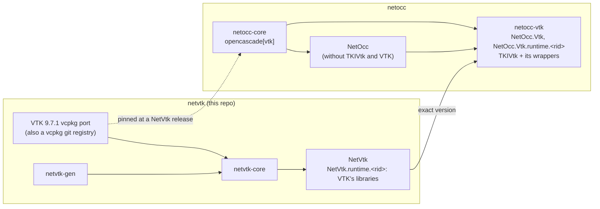

# NetVtk plan

Goal: free, MIT, generated C# bindings for current VTK. They're the base for simulation visualization in .NET (fields on meshes, isosurfaces, cuts, glyphs, streamlines, volume rendering, result readers), and through `NetOcc.Vtk` they show OCCT shapes in the same scenes. No maintained open-source .NET binding of VTK exists: Kitware's ActiViz is proprietary and licensed per version, and its last open-source release is 5.8.

## Repositories and packages

- **NetVtk** (this repo) wraps VTK's classes with their names unchanged; its runtime packages hold VTK's libraries and their dependencies. It works without OCCT.
- **NetOcc.Vtk** (`netocc/netocc-vtk`) wraps OCCT's TKIVtk (`IVtk`, `IVtkOCC`, `IVtkVTK`, `IVtkTools`) in `OCC.Core.IVtk*`. `IVtkTools_ShapeDataSource` and its siblings derive from NetVtk's proxies, so they plug into VTK pipelines. It depends on NetOcc and on exactly one NetVtk version.
- **One VTK build.** TKIVtk runs VTK's inline code, compiled against VTK's headers, so both repositories must build the same VTK. netvtk owns the port and serves it as a vcpkg git registry (`versions/` at the root). netocc-core pins that registry at a NetVtk release commit and builds `opencascade[vtk]` once. NetOcc's packages leave TKIVtk and VTK out. NetOcc.Vtk.runtime ships TKIVtk and its wrapper library only; VTK's libraries come from NetVtk.runtime.

## Decisions (confirmed 2026-10-11)

| Decision | Choice | Why |
|---|---|---|
| VTK version | 9.7.1 (2026-09-26), own overlay port | vcpkg's port is stuck on 9.3.0 (2023) |
| Module set | about 20 modules first (below) | package size, build time |
| C# namespace | one namespace, `Vtk` | VTK's class names are unique (`vtk` prefix); a pipeline touches six modules or more |
| Target frameworks | NetOcc's set (net35 to net10.0, netstandard2.0) | NetOcc.Vtk needs both; the typemap library already handles CLR 2 |
| Generator | fork netocc-gen (libclang parser, mapper, writer) and swap OCCT's rules for VTK's | same author and license; extract a shared library once both are stable |
| Versions | `<VTK version>.<revision>` (`9.7.1.1`) | as NetOcc |
| Layout | as netocc: `netvtk-core`, `-generator`, `-documentation`, `-demos` | same tooling and workflows |

First modules: CommonCore, CommonDataModel, CommonExecutionModel, CommonMath, CommonTransforms, CommonColor, FiltersCore, FiltersGeneral, FiltersGeometry, FiltersSources, FiltersModeling, IOLegacy, IOXML, RenderingCore, RenderingOpenGL2, RenderingAnnotation, RenderingFreeType, RenderingUI, InteractionStyle, InteractionWidgets. This covers what TKIVtk links. The port keeps an `opengl` feature, which OCCT's `vtk` feature asks for.

## How VTK maps (what differs from OCCT)

- **Lifetime** (`VtkObjects.i`): `vtkObjectBase` counts references like `Standard_Transient`. The proxy holds one reference, which Dispose and the finalizer drop (`UnRegister`, SWIG's unref; there is no ref feature). `New()` and `NewInstance()` hand over a reference of their own (spelled `T*`); every other returned object gets one from the wrapper (spelled `T* const`). A C# constructor calls `New()` (`%vtk_new`), so the object factory picks the class (`new vtkRenderWindow()` is a `vtkWin32OpenGLRenderWindow`). `vtkSmartPointer<T>`, `vtkNew<T>` and `vtkWeakPointer<T>` map to proxies.
- **Hints:** VTK marks its headers for wrappers (`vtkWrappingHints.h`). netvtk-gen defines `VTK_SIZEHINT`, `VTK_WRAPEXCLUDE`, `VTK_NEWINSTANCE` and the other hints as `annotate` attributes, which libclang reports (`vtk::sizehint(6)` on `vtkDataSet::GetBounds`); not through `__VTK_WRAP__`, which changes what the headers declare. A size hint is a return of `NETVTK_SIZE<N>` (`%netvtk_sized_return`): a C# array copied right after the call. Some hints name parameters (`sizehint(pts, npts)`).
- **Macros:** `vtkSetMacro`, `vtkGetMacro` and `vtkTypeMacro` expand to ordinary members, and libclang sees them expanded.
- **Modules:** a module's headers and dependencies come from VTK's `vtk.module` files and the CMake module properties it installs, not from OCCT's `PACKAGES.cmake` (check what the install carries).
- **Errors:** VTK reports through `vtkOutputWindow` and error events, not exceptions. They go to C# as an event, with exceptions opt-in.
- **Callbacks:** `vtkCommand` observers are C# subclasses through directors (`Directors.i`, forked from netocc's); C# events on top come in phase 3. An exception an override throws doesn't unwind through VTK, which isn't written for it: the callback returns, VTK goes on, and the wrapped call that led to it throws a `VtkException` carrying the C# one (NetVtkRuntime holds its number per thread, across the wrapper libraries).
- **Width typedefs:** `vtkIdType` (64-bit ids on every architecture: the port sets `VTK_USE_64BIT_IDS`) and `vtkMTimeType` keep their names in the wrappers, which compile on every platform; C# sees `long` and `ulong`. C `unsigned long` (event ids, observer tags) is a C# `ulong`, range-checked on Windows.
- **Data:** arrays hold fields of millions of values, so they need bulk copies (`ToArray`, `FromArray`), `Span<T>` on .NET Core, and zero-copy where VTK marks it.
- **Templates:** `vtkAOSDataArrayTemplate<T>` and its kin are the bases of `vtkDoubleArray` and the other typed arrays: classes named by their arguments (`vtkAOSDataArrayTemplate_double`), as netocc-gen handles instances. Instances over `long long` are in (VTK's 64-bit types are `long long` on every platform: `vtkIdTypeArray`'s base); over `size_t`, `long` and `wchar_t` out; VTK's third-party templates (`vtknlohmannjson/`) out.

## Phases

### 0. Spike: prove the risky parts

- VTK 9.7.1 overlay port with the module set, built on x64-windows. Record build time, installed size and library count.
- A hand-written SWIG module over about ten classes (`vtkObjectBase`, `vtkObject`, `vtkConeSource`, `vtkPolyDataMapper`, `vtkActor`, `vtkRenderer`, `vtkRenderWindow`, `vtkCommand`, `vtkPolyData`, `vtkDoubleArray`). It proves reference counts (a test reads `GetReferenceCount`), size hints and an observer callback.
- A cone in a WPF and an Avalonia window: VTK's render window as a child of our window (`SetParentId`/`SetWindowId`), with mouse input fed to an interactor.
- libclang reading `[[vtk::sizehint]]` with `__VTK_WRAP__` defined.
- Exit: the numbers, a go or no-go on lifetime and hosting, and the decisions above confirmed.

**Done 2026-10-11; go given the same day.** Results:

| | win-x64 | win-x86 |
|---|---|---|
| VTK 9.7.1 build (vcpkg, release, 20 threads) | 16.6 min first, 18.1 min rebuild | 18.3 min |
| VTK libraries | 68 DLLs, 81 MB | 68 DLLs, 75 MB |
| Staged runtime (VTK + 5 NetVtk libraries), zipped | 20.9 MB | 19.5 MB |
| Spike tests (18), net10.0 and net48 | pass | pass |

- **Port:** no dependency on other ports: VTK's own third-party copies, with mangled symbols. VTK's two executables go to `tools/vtk`, where its CMake targets point (the config fixup rewrites them). Installed headers: 33 MB.
- **Lifetime: go.** Tests read the reference counts: `New()` and the constructor give 1, a returned object 2 (owner and proxy), `Dispose` and the finalizer drop the proxy's reference, an object set on another outlives its proxy, `SafeDownCast` gives the derived proxy or null.
- **Size hints: go.** `GetBounds()` (6), `GetColor()` (3), `GetSize()` (2 ints), `GetRange()` (2) are C# arrays. libclang reports the hints as `annotate` attributes: 7 of `vtkDataSet`'s 83 methods, 29 of `vtkProperty`'s 239.
- **Callbacks: go.** A C# `vtkCommand` is called back with its caller; VTK keeps an observer only it holds alive; an exception in an observer comes out of `Modified()` as a `VtkException` whose InnerException is the C# one, and the next call is clean.
- **Rendering: go.** An offscreen render draws a cone actor, on x64 and x86. The WPF (`HwndHost`) and Avalonia (`NativeControlHost`) viewers draw a cone coloured by a point field into our child window, VTK's `vtkGenericRenderWindowInteractor` fed from our window procedure; the visual check is the user's.
- **The managed assembly** builds for all eight targets, net35 included.
- **For later phases:**
  - `vtkRenderWindow::Finalize()` clashes with C#'s finalizer (CS0465): netvtk-gen leaves it out, logged (phase 2).
  - The finalizer may delete rendering objects on its thread, where no OpenGL context is current: phase 3 decides (release them on their thread, or require Dispose).
  - VTK's `char*` returns (`vtkGetStringMacro`) are declared `const char*`; enums declared through macros (`vtkCommand::EventIds`) need libclang's values.
  - The forked typemaps' comments still name OCCT examples, and `Std.i` uses netocc's `%occt_valueclass` (not included yet): phase 1.

### 1. netvtk-core foundation

- `build.py` (tools, vcpkg, generate, native, test, pack), taken from netocc-core's and trimmed.
- Typemap library: netocc-core's general typemaps (numbers, strings, streams, arrays, directors, keep-alive), copied and adapted. VTK's lifetime typemaps are new.
- CMake: one native library per module group (a Windows DLL exports at most 65535 functions), plus `NativeLibraryLoader`.
- Tests on every framework, x64 and x86; Linux and macOS builds.

**Done 2026-10-11.** `build.py` has netocc-core's commands (tools, vtk, generate, native, test, pack, test-package, version, changelog, change, release) with VTK's version in place of OCCT's; `test/test_build.py` (15 tests) checks its rules. The typemap library is netocc's minus OCCT (no handles or collections) plus `VtkObjects.i`; ValueTypes.i and Std.i are in, ready for VTK's small value classes. The runtime packages carry `THIRD-PARTY-NOTICES.txt` (124 KB: NetVtk's license and NOTICE, VTK's Copyright.txt and the 49 module and third-party licenses VTK installs). `format.py` and the pinned clang-format pass. Verified:

| | tests (22) | packages |
|---|---|---|
| win-x64 | net10.0, net8.0, net6.0, net48, net472, net462, the net45 and net452 builds, net35 on CLR 2 | NetVtk 275 KB, runtime 23.3 MB; package tests (net8.0, net48) pass |
| win-x86 | the same | runtime 21.6 MB; package tests pass |
| linux-x64 (Docker, Xvfb) | net10.0, net8.0, net6.0 | package test (net8.0) passes; VTK builds in 14 min there |
| osx-arm64 | CI only (phase 5), once pushed | |

### 2. netvtk-gen

- Fork netocc-gen: parser, mapper, writer and golden tests. Drop OCCT's rules (handles, NCollection, gp value types, OCAF) and add VTK's (lifetime, hints, smart pointers, VTK's templates, module discovery).
- Skip logs per module, `generate --check`, deterministic output.
- Generate the first module set, replacing phase 0's hand-written module.

**Done 2026-10-11.** netvtk-gen writes the 20 modules: 2,102 classes, 238 enums, 731 members skipped with a reason (`VTK_WRAPEXCLUDE`'d members aren't logged). OCCT's rules are gone (collections, range-for, legacy handles, window handles, TCollection, `std::pair`); `netvtk-generator/CLAUDE.md` lists what is VTK's. Fixes the builds forced: function pointer typedefs by name (`vtkThreadFunctionType` is `__stdcall` on win-x86), VTK's Windows-only headers and `GetClassNameA`/`W` out (Linux). Fixes the skip review found: `long long` instances in (`vtkIdTypeArray`'s typed members), compiler builtins in inline bodies link (`vtkCellArray::GetCellAtId`), VTK's third-party templates out. Verified:

| | |
|---|---|
| netvtk-gen | 180 unit and golden tests pass; the golden fixture is a fake VTK install (`Golden/vtk`) |
| `generate --check` | clean (about a minute) |
| win-x64, win-x86 | SWIG, native, the 23 tests on every framework (net35 on CLR 2) |
| linux-x64 (Docker) | native, the 23 tests on net10.0, net8.0, net6.0, package test |
| format | `format.py --check` clean |

Left for later: `std::vector` parameters and returns (about 100 members, mostly internals), `PrintSelf` (65, a stream VTK might keep: phase 3 gives `ToString`), the `Transient` identifiers in the generator (VTK objects now).

### 3. Data and interop

- Bulk array access and zero-copy views.
- Observers as C# events; `vtkOutputWindow` routed to C#.
- A public native-pointer interop (`NativePointer`, a factory from a pointer) for NetOcc.Vtk and C++/CLI users.
- `protected` pointer constructors on the proxies, so another assembly's proxies can derive from them.
- The SWIG interface files ship with each release, for NetOcc.Vtk's `%import`.

**Done 2026-10-12.** Proxies are `partial`; hand-written members in `netvtk-core/src/NetVtk/<Module>/` and `extras/CommonCore.i`:

- **Arrays:** the typed arrays (`vtkDoubleArray` and its ten siblings, through their `vtkAOSDataArrayTemplate<T>` base) have `ToArray`, `CopyFrom`, `FromArray`, and on .NET 6+ `AsSpan` (the array's memory) and `CopyFrom(ReadOnlySpan<T>)`; bulk copies go through NetVtkRuntime's `memcpy`, on every .NET. `vtkDataArray.ToDoubleArray()` converts any array.
- **Observers:** `AddObserver(id, handler)`, `Observe` (an `IDisposable`), the events `ModifiedEvent`, `ErrorEvent`, `WarningEvent`, and `StartEvent`, `ProgressEvent`, `EndEvent` on algorithms; `VtkEventArgs` reads the call data (`GetText`, `GetDouble`).
- **Messages:** `VtkOutput` installs a C# `vtkOutputWindow` (a new director): VTK's errors and warnings go to `VtkOutput.Message`, to `Trace` without a handler; no window, no console.
- **Interop:** `NativePointer`, `vtkObjectBase.FromNativePointer<T>(pointer, ownsReference)`; `ToString()` is VTK's `Print`. NetVtk carries its SWIG files in `swig/` (4.2 MB, 0.4 MB packed).
- **Rendering thread:** `VtkFinalizer.Context` makes the finalizer post releases to the thread that renders.
- **Generator:** VTK's width typedefs are spelled by name by value too (a director's `GetMTime` override must return `vtkMTimeType`, `unsigned long` on Linux); directors get no `%vtk_new`.

Verified: 42 tests (41 on the frameworks without `Span`) on every framework, x64 and x86, and on Linux (Docker: net10.0, net8.0, net6.0); package tests on x64, x86 and Linux; netvtk-gen's 181 tests; `generate --check`; `format.py --check`; clang-format 20.1.8 over `src/Native`. Sizes: NetVtk 18.2 MB (eight 11 MB assemblies, one per framework), NetVtk.runtime.win-x64 26.3 MB, win-x86 27.0 MB.

### 4. Viewers and demos

- `netvtk-demos`: WPF and Avalonia hosts (a child window, like netocc-demos' `ViewerWindow`). Linux (X11) and macOS (NSView) come later.
- Demo: read a `.vtu`, colour by a field, scalar bar, cut plane, contour, warp by displacement. Analysis Situs' `asiVisu` shows what a CAE viewer needs; no copies.

**Done 2026-10-12.** Both viewers run on the packed NetVtk (`nuget.config`, `NetVtk.version.props`, AnyCPU with both Windows RIDs). They open a `.vtu` (or legacy `.vtk`) or the sample (`--sample`: a cantilever beam of 1,280 hexahedra, its displacement, bending stress and a temperature), and show it warped by its displacement, coloured by a field (a vector by its magnitude) with a scalar bar, with a cut plane across the longest axis and contours of a scalar field; a toolbar picks the field and switches each. Verified: 11 tests of the viewer library (the sample written and read back, the pipeline's cut, contours and warp, the opener, and the whole scene rendered off the screen, from blue to red); the user looked at both viewers.

### 5. Release infrastructure

- Workflows from netocc: build (four RIDs, vcpkg cache with VTK), generator, format, changelog, release, docs.
- Rendering tests without a GPU: Mesa's llvmpipe on the Windows and Linux runners (to verify). Otherwise compile-only, like netocc's visualization samples.
- nuget.org Trusted Publishing; THIRD-PARTY-NOTICES for VTK and its dependencies; the registry's `versions/` updated with each release.
- Documentation site: getting started, VTK in C#, lifetimes, pipelines, data arrays, hosting.

**Done 2026-10-12.** The workflows are netocc's, for netvtk (`.github/`): build (four RIDs, VTK from vcpkg's binary cache, pack, package tests, demos and samples, publish), generator, format, changelog, release PR, docs, Dependabot. Rendering tests run on Linux (Xvfb, Mesa's llvmpipe, as in Docker); the Windows and macOS runners leave them out (`build.py test --no-rendering`). The repository is a vcpkg registry (`versions/`, `build.py registry`; build.yml checks it). The documentation site (`netvtk-documentation/`): 16 articles, every example a region of one of 51 sample tests on the packed NetVtk, the READMEs checked against theirs, a class index linking VTK's nightly reference (no 9.x release reference exists). The first release's changelog entry is in `netvtk-core/changes/`. Verified: the samples (51) pass, docfx builds with 0 warnings, `classes.py --check` finds no broken link, the workflows parse as YAML, `build.py test --no-rendering` leaves out the one rendering test (x64, net10.0 and net35), `test_build.py` passes. Not verified: the workflows themselves, which run once pushed.

**Your steps before the first release** (nothing here was done on GitHub or nuget.org):

1. Create the repository `paulbuechner/netvtk` (public), push `main` (and `next` for prereleases).
2. Settings > Pages > Build and deployment > Source: GitHub Actions.
3. Settings > Actions > General > Workflow permissions: allow GitHub Actions to create and approve pull requests (the release PR).
4. Settings > Environments: create `release` (optionally with yourself as a required reviewer: publishing then waits for you).
5. nuget.org > Trusted Publishing: a policy for owner `paulbuechner`, repository `netvtk`, workflow `build.yml`, environment `release`. Settings > Secrets and variables > Actions > Variables: `NUGET_USER`, the nuget.org profile name that owns the policy. Optionally reserve the ID prefix `NetVtk` on nuget.org.
6. Create the label `no changelog` (changelog.yml skips pull requests that carry it).
7. The first build runs VTK cold on four runners (about 20 minutes each), then from the cache. Merging the release PR (release.yml opens it from the pending entry) publishes `9.7.1.1`; its tag `v9.7.1.1` is the commit NetOcc pins the vcpkg registry at.

### 6. NetOcc.Vtk (in netocc)

- **netocc-core:** pin netvtk's registry and build `opencascade[vtk]`; stage NetOcc without TKIVtk and VTK. CI gets the VTK build, cached.
- **netocc-gen:**
  - VTK types come from NetVtk's interface files (`%import`, its `classes.json`).
  - `IVtkTools_*` derive from NetVtk proxies.
  - libclang gets VTK's include directory.
- **`netocc-vtk/`:**
  - The NetOccVtk native library (the only one linking TKIVtk), and packages `NetOcc.Vtk` and `NetOcc.Vtk.runtime.<rid>` with an exact NetVtk dependency.
  - Loader order: NetVtk's libraries load first.
  - Tests, and a demo with an OCCT shape and a result field in one scene, with sub-shape picking.
- netocc's root `CLAUDE.md`, workflows (path filters) and documentation.

**Done 2026-10-12** in netocc's branch `feat/netocc-vtk` (worktree `D:\buechner\netocc-vtk`, five commits, not pushed):

- **One VTK build.** netocc-core builds `opencascade[vtk]` with `vtk` from this registry (`vcpkg-configuration.json`: `packages: [vtk]`, the baseline a commit of this repository), on triplets identical to this repo's: vcpkg's ABI hash of VTK is the same in both repositories, and each restored the other's build from its binary cache (win-x64 `46931a65…`, win-x86 `3bb2422b…`, linux-x64 `f3923e0c…`). NetOcc's stage holds neither TKIVtk nor VTK: 69 files per Windows RID as before, and its libraries reference neither.
- **Changed from the plan (approved):** netocc-gen takes NetVtk's classes from its `wrapper/*.i` (`%vtk_object`), and the modules include `swig/interop/NetVtkInterop.i` (`%netvtk_object`, `%netvtk_derived`, `%netvtk_new`) instead of `%import`ing NetVtk's typemap library, whose global typemaps would reach NetOcc's own classes. win-x86: OCCT's `IVtk_Types.hxx` refuses 64-bit VTK ids on 32-bit Windows; netocc's overlay port drops that guard (patch `0007`), and `BuildTests` check vtkIdType's 8 bytes and that TKIVtk's compiled VTK version is the loaded one.
- **netocc-vtk:** NetOccVtk (IVtk, IVtkOCC, IVtkVTK, IVtkTools), `NetOcc.Vtk` (NetOcc's frameworks; NetOcc of its own version, NetVtk exactly) and `NetOcc.Vtk.runtime.<rid>` (NetOccVtk and TKIVtk: 0.4 MB unpacked). Its module initializer has NetVtk load VTK, then NetOcc's resolver finds NetOccVtk. A WPF demo shows a part with a temperature field, a scalar bar and click-picked faces. netocc's documentation has an article (VTK scenes) whose examples are tests on the packed NetOcc.Vtk; build.yml builds, tests and packs it on the four RIDs and publishes it after NetOcc.
- **Verified:** NetOcc.Vtk's tests (6, off-screen picking included) on net10.0, net8.0 and net48, x64 and x86; its package tests on net8.0 and net48, x64 and x86; the user looked at the demo. netocc: its tests on every framework, x64 and x86; package tests; `generate --check` clean for netocc-core and netocc-vtk; format check; netocc-gen's 228 tests; the demos and the documentation's samples (68 and 3) on the new packs; docfx without warnings. Linux in Docker: netocc-core with OCCT's vtk feature (467 tests on net10.0, net8.0, net6.0; package tests; no TKIVtk or VTK in the stage), and NetVtk on the VTK build that run made (restored from its archive; 42 tests with rendering, package tests), which also re-checks NetVtk on the triplets it took from netocc.
- **Linux (Docker, after phase 7):** NetOcc.Vtk built on NetVtk's linux-x64 packages: its tests on net10.0 and net8.0 (picking under Xvfb), its package tests, `NetOcc.Vtk.runtime.linux-x64` holding `libNetOccVtk.so` and `libTKIVtk.so.8.0` only, NetOcc.runtime.linux-x64 neither. It found a bug in the test setup, fixed: with a RID, NuGet put NetVtk's VTK libraries beside the test, not beside NetOccVtk.
- **Not verified:** the workflows; osx-arm64 (CI).

**Your steps for netocc**, after NetVtk's (phase 5): push netvtk (its history squashed into the Initial commit, which netocc pins as its registry baseline: rewriting it again breaks the pin), publish NetVtk `9.7.1.1` (`netocc-vtk/NetVtk.props`), then merge `feat/netocc-vtk` into next. Optionally reserve the ID prefix `NetOcc.Vtk` on nuget.org; NetOcc's Trusted Publishing policy covers it (same workflow).

### 7. Breadth

- More modules: volume rendering, and more readers (Exodus, CGNS) through optional port features.
- Linux and macOS hosting, performance work.

**Done 2026-10-12, but macOS hosting:**

- **Modules:** the port's features `volume` (RenderingVolume, RenderingVolumeOpenGL2), `exodus` (IOExodus) and `cgns` (IOCGNSReader), port-version 1 in the registry; NetVtk builds them all, and netocc-core asks for the same features (another feature set would be another VTK build). IOCore is wrapped too: the readers' and writers' base `vtkWriter` (`SetInputData`, `Write`), which the legacy writers lacked in C# before. 25 modules, 77 VTK libraries on Windows. RenderingVolume's companion registers RenderingVolumeOpenGL2's factory. Runtime packages: win-x64 29.5 MB, win-x86 30.0 MB, linux-x64 76.7 MB (Windows' were 26.3 and 27.0 MB); NetVtk 19.1 MB.
- **Linux hosting:** the demos' `X11ViewerWindow`: VTK creates its child window in the host's X11 window (`SetDisplayId`, `SetParentId`), the viewer reads its events on a UI timer; the Avalonia viewer uses it on Linux and builds there. `X11HostingTests` draws into a host's window under Xvfb (Docker; CI's Linux package-tests job runs it).
- **macOS hosting: not done.** An NSView child is the counterpart, but nothing here can run it (no Mac, and CI's runners have no display): left out rather than shipped untried (your decision, 2026-10-12): it comes on a Mac.
- **Performance** (win-x64, .NET 10, 10M doubles): `CopyFrom` 7 ms, `FromArray` and `ToArray` about 45 ms (fresh memory's page faults; uninitialized C# arrays measured no gain), `AsSpan` summed 11 ms, a wrapped call 14 ns, a proxy for an existing object 0.3 µs, `new vtkPoints()` and `Dispose` 5 µs (VTK's own: its factory and its array). `ToDoubleArray` now dispatches VTK's typed arrays to a typed loop: 37 to 18 ms for doubles, 36 to 12.5 ms for floats.
- **Verified:** NetVtk's tests on every framework, x64 and x86 (48 on .NET, 46 on .NET Framework: volume rendering off the screen, an Exodus II round trip, a CGNS file written with VTK's CGNS library and read, the typed `ToDoubleArray` paths); on Linux in Docker (48 on net10.0, net8.0, net6.0, rendering under Xvfb, the viewer library's 12 with X11 hosting, the Avalonia viewer built); package tests x64, x86, Linux; the samples (53); the demos' tests; docfx without warnings, 1,719 class index links; netvtk-gen's 181 tests and `generate --check`; the format check. In netocc: the registry moved to this commit, and vcpkg restored this repository's VTK builds there (win-x64 `b810e274…`, win-x86 `550e15dc…`, linux-x64 `6b7646d3…`), OCCT rebuilt on them, NetOcc's and NetOcc.Vtk's tests pass again.

## Risks

- **Package size:** nuget.org caps a package at 250 MB. The module set keeps NetVtk.runtime small (measure in phase 0).
- **CI:** VTK cold builds on four runners; in netocc, the Actions cache (10 GB per repository) is shared with OCCT.
- **win-x86:** VTK 9.7 on 32-bit Windows is unverified.
- **ABI:** netocc's and netvtk's VTK must be the same build. netocc-vtk's tests compare VTK's version and build options at load.
- **Clean-room:** see `CLAUDE.md`.
