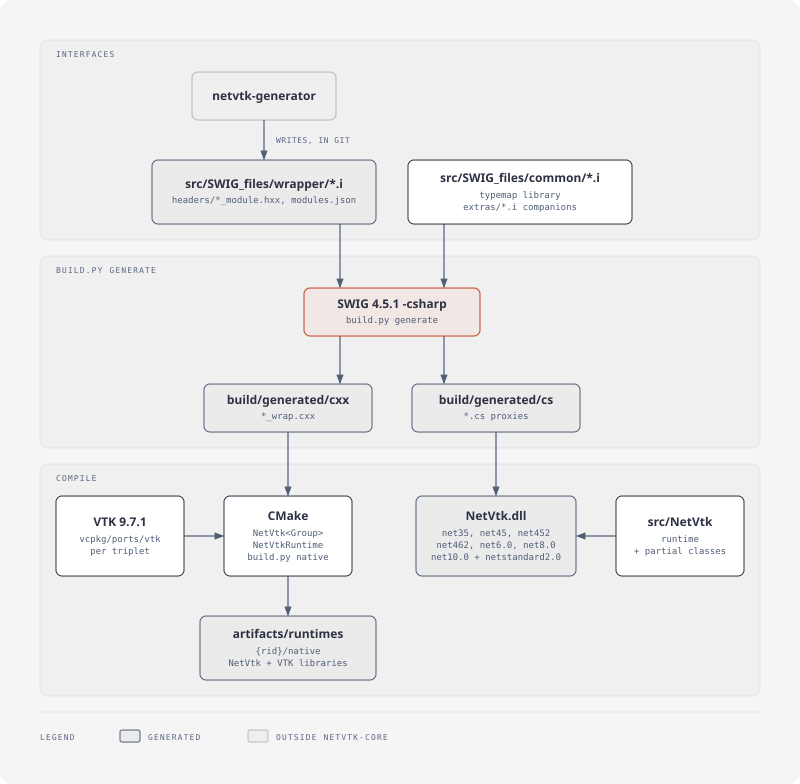
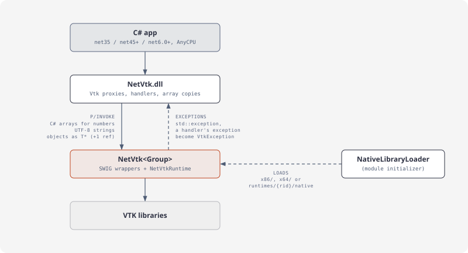

# netvtk-core

The Visualization Toolkit (VTK) 9.7.1 for .NET: SWIG-generated C# bindings in one namespace, `Vtk`, VTK's names unchanged. One AnyCPU package for .NET Framework 3.5 and 4.5+, .NET 6, .NET 8 and .NET 10; natives for win-x64, win-x86, linux-x64, osx-arm64.

25 VTK modules (core, data model, execution, filters, readers and writers, rendering, volumes, interaction), about 2,450 types, are generated by netvtk-generator. Tests green on win-x64 and win-x86 (every framework; net35 also on CLR 2) linux-x64 and osx-arm64 (net10.0, net8.0, net6.0). Open work: [plan](../plan/README.md).

## Install

```bash
dotnet add package NetVtk
```

`NetVtk` pulls in the natives of all four platforms (`NetVtk.runtime.<rid>`, VTK's libraries included). They need:
- **Windows:** the Visual C++ 2015-2022 runtime, x64 or x86.
- **Linux:** glibc 2.35 or newer, an X server or EGL for rendering.
- **macOS:** 14 or newer, on Apple silicon.

.NET apps load the natives from `runtimes/<rid>/native`. .NET Framework apps get them in `x64\` and `x86\` next to the app, so AnyCPU works.

Changes per release: [CHANGELOG.md](CHANGELOG.md).

## Monorepo

The core of the [netvtk monorepo](../README.md): VTK's vcpkg port, typemap library, per-module `.i` (committed), build, C# assembly, tests. It builds without the generator: [netvtk-generator](../netvtk-generator) reads VTK's install and writes `src/SWIG_files/{wrapper,headers}` here, on VTK upgrades.

## Architecture

Build pipeline:

<picture>
  <source media="(prefers-color-scheme: dark)" srcset="assets/readme-build-pipeline-dark.svg">
  
</picture>

Runtime layers:

<picture>
  <source media="(prefers-color-scheme: dark)" srcset="assets/readme-runtime-layers-dark.svg">
  
</picture>

## Build

Needs Python 3.10+, vcpkg (`VCPKG_ROOT`), CMake + Ninja, the .NET 10 SDK with the .NET 6 and 8 runtimes, and on Windows Visual Studio with C++ tools. Per OS: [Building from source](https://paulbuechner.github.io/netvtk/articles/building.html).

```bash
python build.py tools                        # SWIG 4.5.1 from conda-forge into .tools/ (micromamba)
python build.py vtk --triplet x64-windows    # VTK 9.7.1 via vcpkg (about 25 min first time; cached after)
python build.py generate                     # SWIG -> build/generated/{cxx,cs}
python build.py native --triplet x64-windows # NetVtk libraries + VTK's -> artifacts/runtimes/win-x64/native
python build.py test --arch x64              # every framework, net35 on CLR 2; also --arch x86
python build.py docs --triplet x64-windows   # VTK's doc comments as NetVtk.xml for the package (needs ../netvtk-generator)
python build.py pack --rids win-x64,win-x86  # NuGet packages, version <VTK version>.<next revision>-local.<time>
python build.py test-package --arch x64      # the packed NetVtk as an app consumes it
python build.py change fixed "..."           # a changelog entry for the next release, in changes/
```

Triplets: `x64-windows`, `x86-windows`, `x64-linux-dynamic`, `arm64-osx-dynamic` (overlays in `vcpkg/triplets`: release-only). Linux, in Docker (VTK builds once into the named volume):

```bash
docker build --load -f docker/linux-x64.Dockerfile -t netvtk-linux .
docker run --rm -v netvtk-vcpkg-linux:/src/.vcpkg netvtk-linux
```

## Layout

| Path | Content |
|---|---|
| `vcpkg/ports/vtk` | VTK's vcpkg port: the module set, features `volume`, `exodus`, `cgns`, four patches (the Direct3D window makes its own context current and closes its interop device, the hardware selector keeps a multisampled render framebuffer, the render windows' reverse Z); `../versions/` makes the repository its registry |
| `src/SWIG_files/common` | typemap library: VTK objects, directors, exceptions, UTF-8 strings, streams, value types, vectors as C# arrays |
| `src/SWIG_files/wrapper` | one `.i` per VTK module, and one of RenderingOpenGL2's Windows-only headers (`platforms.json`), committed netvtk-generator output; declarations only |
| `src/SWIG_files/headers` | `<Module>_module.hxx` aggregate headers, `<Module>_nested.hxx` flat names of nested types (generated) |
| `src/SWIG_files/extras` | hand-written companions the generated `.i` include: typed arrays' bulk copies, autoinit, a LUID as a long |
| `src/SWIG_files/interop` | `NetVtkInterop.i`, for other SWIG bindings on NetVtk's proxies |
| `src/Native` | NetVtkRuntime: director failures, memory streams, bulk copies |
| `src/NetVtk` | C# project: runtime (native loader, `VtkException`, observers, `VtkOutput`), hand-written partials, generated structs; `README.md` is the package's (nuget.org) |
| `test/NetVtk.Tests` | NUnit 4 tests (lifetimes, arrays, marshaling, pipelines, observers, readers, volumes, interop, picking, Direct3D interop) |
| `test/NetVtk.PackageTests` | the packed NetVtk from `artifacts/packages`, consumed like an app (`build.py test-package`) |
| `pack` | `NetVtk.runtime.<rid>` packages: natives, license notices, .NET Framework copy targets |
| `changes` | changelog entries for the next release (`build.py change`); `../.github/workflows/release.yml` turns them into the release PR |

## License

MIT ([LICENSE](LICENSE)). VTK and the libraries it builds in: [NOTICE](NOTICE), and `THIRD-PARTY-NOTICES.txt` in each runtime package, beside `sbom/sbom.cdx.json`, a CycloneDX SBOM of every file it ships and the libraries they belong to.
