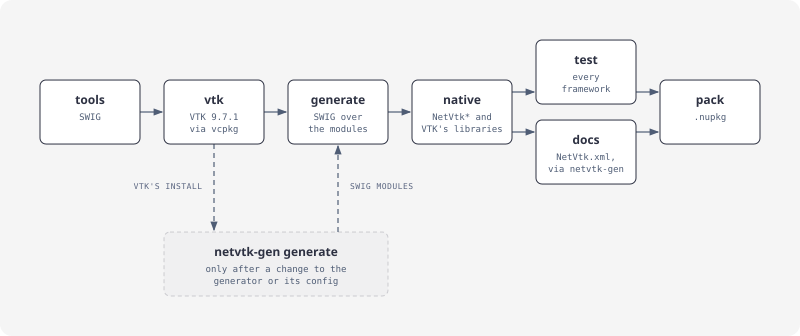
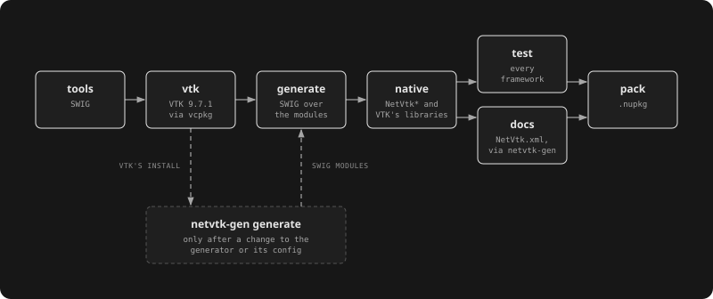

# Building from source

The [netvtk repository](https://github.com/paulbuechner/netvtk) holds four folders, each building on its own:

| Folder | Holds |
|---|---|
| `netvtk-core` | VTK's vcpkg port, the typemap library, the generated SWIG modules, the NetVtk assembly, tests, packaging (`build.py`) |
| `netvtk-generator` | `netvtk-gen`: reads VTK's install, writes netvtk-core's SWIG modules |
| `netvtk-documentation` | this site, and the samples it shows |
| `netvtk-demos` | the WPF and Avalonia viewers |

## netvtk-core

Needs Python 3.10+, a vcpkg clone (`VCPKG_ROOT`), CMake with Ninja, the .NET 10 SDK and the .NET 6 and 8 runtimes for their tests; on Windows Visual Studio with the C++ tools, on Linux the X, GL and EGL headers (or Docker: `docker/linux-x64.Dockerfile` runs every step).




```bash
cd netvtk-core
python build.py tools                        # SWIG from conda-forge into .tools/
python build.py vtk --triplet x64-windows    # VTK 9.7.1 through vcpkg: about 25 minutes the first time
python build.py generate                     # SWIG over the modules
python build.py native --triplet x64-windows # the native libraries into artifacts/runtimes/win-x64/native
python build.py test --arch x64              # every framework; --no-rendering without OpenGL
python build.py docs --triplet x64-windows   # VTK's doc comments as NetVtk.xml, for IntelliSense (needs netvtk-generator)
python build.py pack --rids win-x64,win-x86  # NuGet packages into artifacts/packages
```

Triplets: `x64-windows`, `x86-windows`, `x64-linux-dynamic`, `arm64-osx-dynamic`. Everything vcpkg touches stays under `netvtk-core/.vcpkg/`.

## Regenerating the SWIG modules

Only after changing the generator or its configuration; the generated files are committed.

```bash
cd netvtk-generator
dotnet run --project src/NetVtk.Generator -c Release -- generate --vtk <VTK's install prefix> --core ../netvtk-core
```

`build.py vtk` leaves VTK's install under `netvtk-core/.vcpkg/installed-<triplet>/<triplet>`. With `--check`, `generate` only verifies that the committed files are current.

## This site

```bash
cd netvtk-documentation
dotnet tool restore
python classes.py                            # the class index, from netvtk-core/src/SWIG_files/classes.json
python diagrams.py                           # assets/*.svg and *-dark.svg from assets/*.html (committed)
dotnet test samples -c Release               # the examples, on netvtk-core's packed NetVtk
dotnet docfx docfx.json --serve              # http://localhost:8080
```

The articles include regions of the samples (`[!code-csharp[](../samples/Data.cs#grid)]`), so every example on the site compiles and runs.
