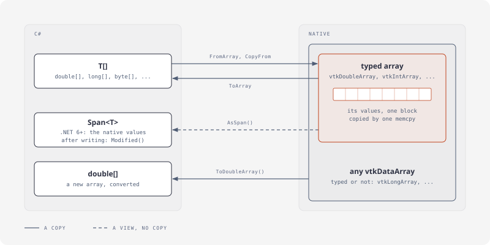
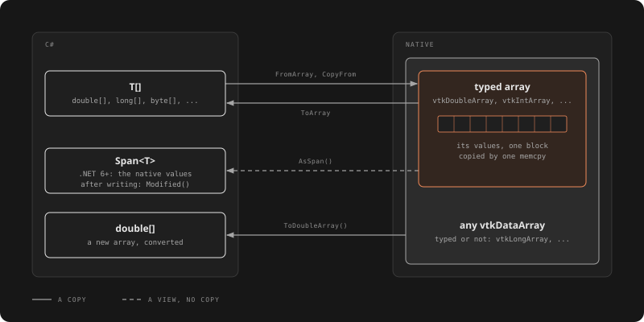

# Data and arrays

A data set is points, cells and fields, each held in VTK arrays. C# fills and reads them in bulk: one native copy per array, not a call per value.

## An unstructured grid from C# arrays

[!code-csharp]

- **Points:** a `vtkDoubleArray` of 3 components, as a `vtkPoints`' data.
- **Cells:** `vtkCellArray.SetData(offsets, connectivity)`, both `vtkIdTypeArray`: `offsets` has one entry more than there are cells. `SetCells(type, cells)` gives all cells one type (`VTKCellType`, cast to `int`).
- **Corner order** is VTK's per cell type: see `vtkHexahedron`, `vtkTetra` and the others in the [class index](../classes/CommonDataModel.md).

## Fields

[!code-csharp]

A point field has a tuple per point (`GetPointData()`), a cell field one per cell (`GetCellData()`). `SetActiveScalars` makes a field the point data's `GetScalars()`; mappers and filters also take fields by name, see [Results](results.md).

## Reading fields back

[!code-csharp]

## Bulk copies

[!code-csharp]

| Member | On | Does |
|---|---|---|
| `FromArray(values, components)` | the typed arrays | a new array with a copy, in tuples of `components` (default 1) |
| `ToArray()` | the typed arrays | a copy of all values, no conversion |
| `CopyFrom(values)` | the typed arrays | replaces the values, resizing the array; a partial tuple throws `ArgumentException` |
| `AsSpan()` | the typed arrays, .NET 6+ | the array's own memory, no copy |
| `ToDoubleArray()` | any `vtkDataArray` | all values, converted to `double`: a typed loop for VTK's arrays, value by value for the others |

The typed arrays are those deriving from `vtkAOSDataArrayTemplate<T>`: `vtkDoubleArray`, `vtkFloatArray`, `vtkIntArray`, `vtkIdTypeArray`, `vtkUnsignedCharArray` and the other fixed-width ones. `vtkLongArray` and `vtkUnsignedLongArray` (C `long`, whose width differs between platforms) derive from `vtkDataArray` in C#: `ToDoubleArray()` only.

> [!WARNING]
> Writing through `AsSpan()` doesn't mark the array modified: call `Modified()`, or the pipelines that use it won't run again.

[!code-csharp]
