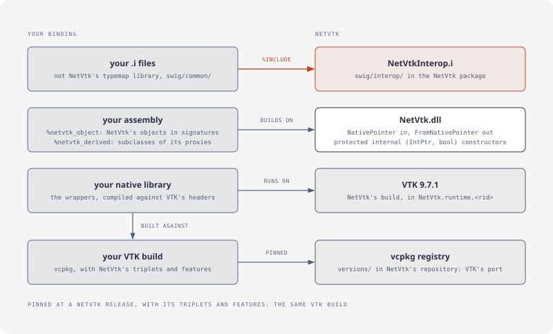
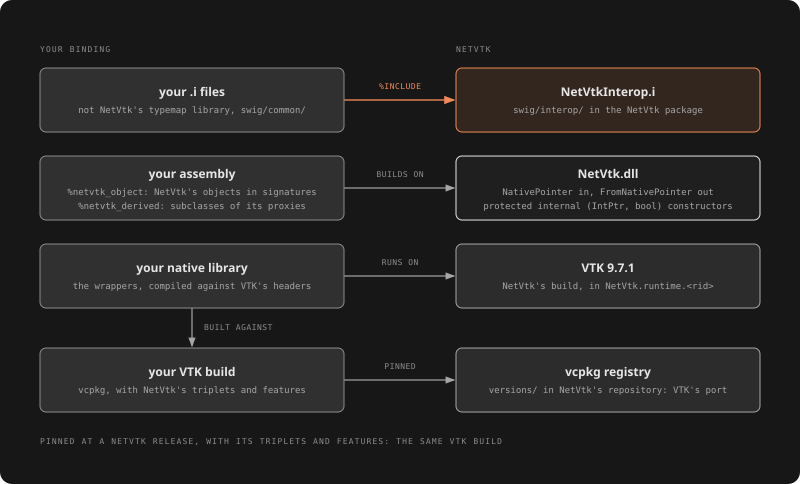

# Native interop

For C++ that takes VTK objects (C++/CLI, a native library of your own) and for SWIG modules that build on NetVtk's.

## Native pointers

[!code-csharp]

- **`NativePointer`** is the object's `vtkObjectBase*`, valid while the proxy holds its reference: keep the proxy alive and undisposed while C++ uses it. `IntPtr.Zero` once disposed.
- **`vtkObjectBase.FromNativePointer<T>(pointer)`** gives a proxy with a reference of its own, or null for `IntPtr.Zero`. An object that isn't a `T` throws `InvalidCastException`, holding nothing.
- **`ownsReference: true`** makes the proxy take over a reference the caller holds (a pointer C++ got from `New()`) instead of adding one.

## The SWIG files

The NetVtk package carries the SWIG interface files it was built from, in its `swig/` folder:

| Path | Holds |
|---|---|
| `wrapper/` | one SWIG module per VTK module, 25 |
| `common/` | the typemap library: VTK objects and their references, strings, numbers, streams, directors, exceptions |
| `extras/` | the hand-written companions: the typed arrays' bulk members, the rendering modules' registration |
| `headers/` | each module's header and nested-type header |
| `interop/` | `NetVtkInterop.i`: NetVtk's objects in another SWIG binding |
| `classes.json`, `modules.json` | every type per VTK module, and the modules per native library |

## A binding on NetVtk

A SWIG binding of your own `%include`s `interop/NetVtkInterop.i`, not the typemap library, whose typemaps use NetVtk's internals and whose global ones would reach the binding's own classes. `%netvtk_object(T)` before a declaration that takes or returns NetVtk's `T` passes it as NetVtk's proxy (`NativePointer` in, `FromNativePointer` out, with NetVtk's reference rules); `%netvtk_derived(T, Base)` makes the binding's own VTK class `T` a subclass of NetVtk's proxy `Base`, whose `(IntPtr, bool)` constructor is `protected internal` for that, and `%netvtk_new(T)` gives it a C# constructor calling `T::New()`.

The binding's native library compiles against VTK's headers but runs on the VTK libraries `NetVtk.runtime.<rid>` brings: build it against the same VTK. [NetVtk's repository](https://github.com/paulbuechner/netvtk) is a vcpkg registry of VTK's port (`versions/`); pinned at a NetVtk release's commit, with copies of `netvtk-core/vcpkg/triplets` and the features `netvtk-core/vcpkg.json` asks for, vcpkg builds the same VTK, with the same ABI hash, and either binary cache serves the other.
