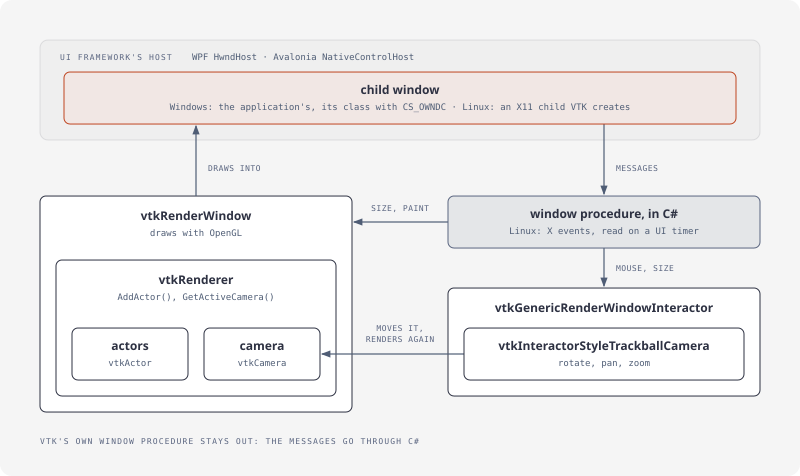
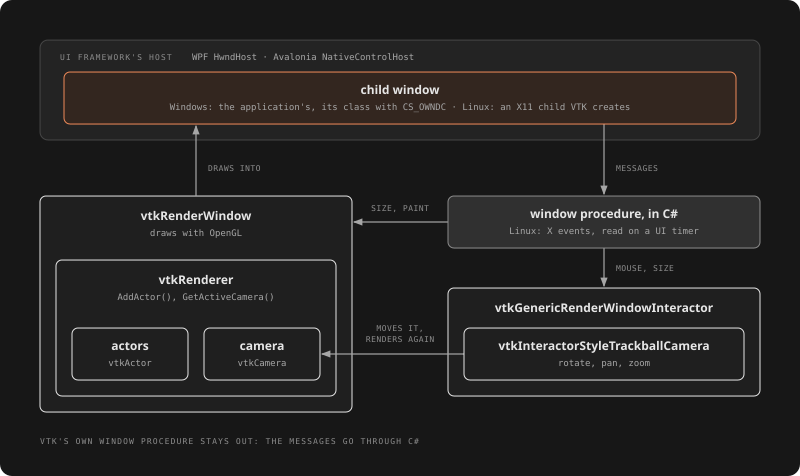

# Rendering and hosting

VTK draws with OpenGL, into a window of its own, a window the application gives it, or an offscreen buffer.

## Off the screen

[!code-csharp]

The image's scalars are the pixels: `vtkUnsignedCharArray.ToArray()` copies them, as in [Getting started](getting-started.md#a-picture). Rendering needs OpenGL 3.2: a GPU's driver, or Mesa's llvmpipe (on Linux, under Xvfb).

## Volumes

An image's values drawn as a volume, through transfer functions for opacity and colour:

[!code-csharp]

`vtkGPUVolumeRayCastMapper.New()` and `vtkFixedPointVolumeRayCastMapper` pick one way to draw; `vtkSmartVolumeMapper` picks for the GPU at hand. Unstructured grids go through `vtkUnstructuredGridVolumeRayCastMapper` or `vtkProjectedTetrahedraMapper`.

## In an application's window

The application makes a child window (an HWND on Windows); VTK's render window draws into it, and VTK's interactor gets the window's size, paint and mouse messages from C#:

[!code-csharp]

- **WPF:** an `HwndHost` creates the child window in `BuildWindowCore`.
- **Avalonia:** a `NativeControlHost` creates it in `CreateNativeControlCore`, after the window shows.
- **The window class** has `CS_OWNDC`: OpenGL needs its own device context. Its procedure calls the view; VTK's own window procedure stays out, so an exception a C# observer throws comes back to C#.

The [demos](https://github.com/paulbuechner/netvtk/tree/main/netvtk-demos) do all of this in a WPF and an Avalonia 12 viewer that open `.vtu` results; `NetVtk.Viewer` holds the shared part (`VtkViewer`, `ViewerWindow`).

**Linux (X11):** Avalonia's `NativeControlHost` gives an X11 window id. On a display connection the application opens and hands to VTK (`SetDisplayId`), VTK creates the child window there itself (`SetParentId`, `Initialize`, then `GetGenericWindowId()`), with the visual its OpenGL context needs; the application selects the window's mouse and structure events on that connection and passes them on to VTK's interactor, polling from a UI timer. The demos' `X11ViewerWindow` does this; its test draws into a host's X11 window under Xvfb.

**macOS:** Avalonia's `NativeControlHost` takes an NSView. The application registers an NSView subclass through the Objective-C runtime and hands an instance to VTK (`SetWindowId`), whose OpenGL context draws into it; the subclass's overrides pass draws, frame size, backing-scale changes and mouse events on to VTK's interactor, in pixels (`setWantsBestResolutionOpenGLSurface:`), with VTK's DPI at 72 a point so text keeps its size on a Retina screen. AppKit calls them on the main thread, where VTK's Cocoa render window must be made and rendered too, even off the screen. The demos' `CocoaViewerView` does this; its test draws into a window's content view, in a process of its own.

## The rendering thread

Render windows, renderers, mappers, actors and textures release OpenGL resources when they go, which needs the thread that renders: create, use and dispose them there, the render window last. For what the garbage collector finalizes, set `VtkFinalizer.Context` on that thread, as `InitializeOnUiThread` above does: the finalizer then posts the releases to it. See [Object lifetimes](lifetimes.md#threads).

## Direct3D

On Windows, `vtkWin32OpenGLDXRenderWindow` renders into a texture an application's Direct3D 11 device shares, for a view Direct3D composes. It needs the driver's `WGL_NV_DX_interop`.

- **The device:** give the window the application's device context (`SetD3DDeviceContext`) before `Initialize`. The device VTK would create asks for Direct3D's debug layer, which fails without Windows' Graphics Tools. `SetAdapterId` takes the adapter's LUID as a `long`.
- **Locking:** render into the shared framebuffer, and read it, between `Lock` and `Unlock`.
- **Samples:** the shared textures have one sample: match the window's with `SetSharedTextureSamples`, or render without (`SetMultiSamples(0)`). Changing the window's samples re-creates its render framebuffer: share the new one with `RegisterSharedRenderFramebuffer`, after a render.
- **Several windows** work in one thread, and a disposed window lets go of the Direct3D device ([VTK's patches](design.md#vtks-patches)).
- **Share while small:** NVIDIA's driver keeps the memory a texture held when it was registered after being attached to a framebuffer, as `RegisterSharedRenderFramebuffer` registers the render framebuffer's, until the process ends: 25 MiB a window at 1600 x 1000 and 4x MSAA. Share it while the window is 1 x 1, after its first render, then resize: resizing costs nothing more.

## Reverse Z

`SetUseReverseZ(true)` on a render window gives it 32-bit float depth from 1 at the near plane to 0 at the far one: as precise far away as near, whatever the clipping range's ratio, so the near plane can come close to the eye in a large scene.

- It needs OpenGL 4.5 or `ARB_clip_control`; without, the window turns it off and warns.
- Depth read from the window is reversed (`GetZbufferDataAtPoint`: 0 over nothing), and the renderer's `DisplayToWorld` follows it: a depth read goes back to its world point.
- Polygon offsets (coincident topology) still keep lines over their surfaces.
- What computes, compares or converts depth itself follows it: impostor spheres and tubes (`RenderPointsAsSpheres`, `RenderLinesAsTubes`), the sphere and stick mappers, 2-D actors and labels, depth peeling, OIT, SSAO, EDL, depth of field, shadow maps, the skybox, pickers, widgets and the volume mappers. Dual depth peeling, SSAO, EDL, depth of field, point fill, the shadow baker and the CPU volume mappers work on `1 - depth`: right, at conventional precision.

With a clipping range of 0.001 to 100,000, two quads 0.01 apart at 10,000 draw in depth order; 32-bit fixed-point depth draws the far one over the near one. With 0.01 to 100,000, a depth read at 25,000 goes back to its point within 0.5; fixed point is 3,148 off.

## Picking

`vtkHardwareSelector.New()` (the object factory makes OpenGL's) tells what each pixel of a rendered window shows: `SetRenderer`, `SetArea`, `CaptureBuffers()`, then `GetPixelInformation(position)`, a `vtkHardwareSelector_PixelInformation` with `Valid`, `Prop` and `AttributeID`. In a multisampled window its passes render without samples, and the window keeps its render framebuffer ([VTK's patches](design.md#vtks-patches)).

## GPU times

A render window's `GetRenderTimer()`, with `SetLoggingEnabled(true)`, times its renders on the GPU: render until `FrameReady()` (two renders, in netvtk-core's tests), then `PopFirstReadyFrame()` gives a `vtkRenderTimerLog_Frame` whose `Events` hold each event's `Name`, `ElapsedTimeMilliseconds()` and nested `Events`.
