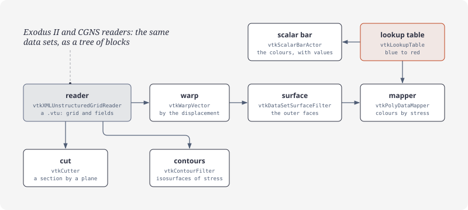
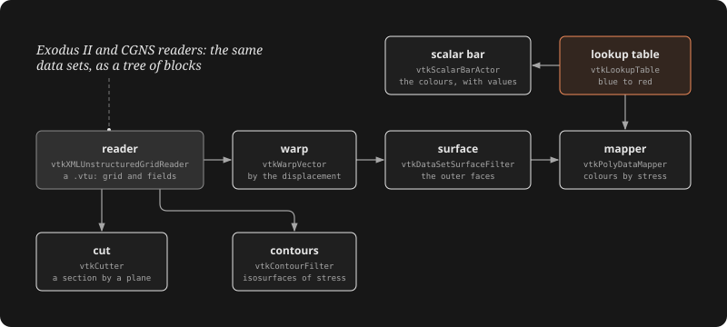

# Results

A recipe for simulation results: read a `.vtu`, colour its surface by a field with a scalar bar, cut it, contour it, warp it. The samples' result is a cantilever beam: 160 hexahedra, clamped at x = 0 and bent down by a load at its tip, with the point fields `displacement` (a vector) and `stress`.

## Reading

[!code-csharp]

A legacy `.vtk` file reads the same way through `vtkUnstructuredGridReader`. A file that doesn't read reports an error and leaves the output empty; it throws nothing, see [Observers and messages](observers.md#messages).

## Exodus II and CGNS

Solvers' own formats read into the same data sets, as a tree of blocks (`vtkMultiBlockDataSet`):

[!code-csharp]

`vtkCGNSReader` reads CGNS files alike: `SetFileName`, `EnableAllPointArrays` (or `EnableAllCellArrays`), `Update`; its output's blocks are the file's bases and their zones. `NewIterator()` on the output walks the leaves, whatever the tree. VTK writes no CGNS.

## Fields

[!code-csharp]

## Colouring by a field

[!code-csharp]

- `vtkDataSetSurfaceFilter` gives the grid's outer faces, with their fields, for a polydata mapper to draw.
- `SetScalarModeToUsePointFieldData` and `SelectColorArray` pick the field by name; `UseLookupTableScalarRangeOn` keeps the table's range.

## Scalar bar

[!code-csharp]

## Cut

[!code-csharp]

The section carries the fields, interpolated: draw it with a mapper of its own and the same lookup table.

## Contours

[!code-csharp]

`GenerateValues(n, first, last)` spaces `n` values evenly, both ends included.

## Warp

[!code-csharp]

## All together

The [demos](https://github.com/paulbuechner/netvtk/tree/main/netvtk-demos)' viewer builds this pipeline once (`ResultScene` in `NetVtk.Viewer`) and switches its parts: the warp, the field with its scalar bar, a cut plane across the longest axis, contours, the surface see-through while a cut or contours show. It also colours by cell fields (`SetScalarModeToUseCellFieldData`), contours them after `vtkCellDataToPointData`, and colours vectors by their magnitude (`SetVectorModeToMagnitude` on the lookup table, the range from `GetRange(-1)`).
