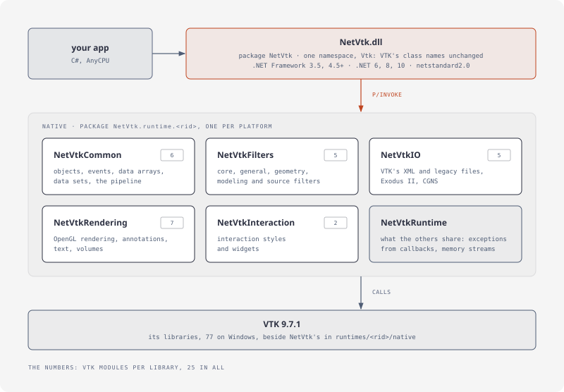
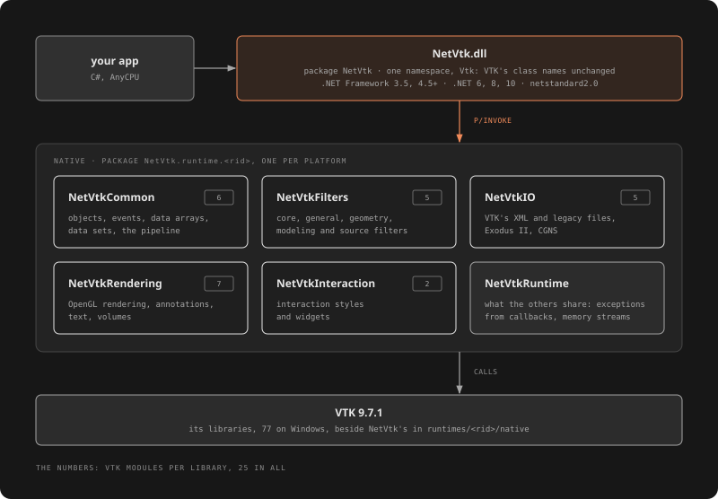

# NetVtk

The [Visualization Toolkit](https://vtk.org) (VTK) 9.7.1 for .NET: C# bindings generated from VTK's headers, VTK's class and method names unchanged, in one namespace, `Vtk`. For simulation results: fields on meshes, isosurfaces, cuts, warps, scalar bars. One AnyCPU package for .NET Framework 3.5 and 4.5+, .NET 6, 8 and 10, and netstandard2.0, with natives for win-x64, win-x86, linux-x64 and osx-arm64.

```bash
dotnet add package NetVtk
```

## A program

A sphere's height as a field on its surface, cut into nine rings, written as a `.vtp` file:

[!code-csharp[](samples/Programs/Contours.cs#program)]

VTK's pipeline, call for call. How C++ signatures look in C#: [From C++ to C#](articles/mapping.md).

## Covered

25 of VTK's modules: data sets and arrays, the pipeline, the core, general, geometry, modeling and source filters, VTK's XML and legacy files, Exodus II and CGNS, OpenGL rendering with annotations, text and volumes, interaction styles and widgets. See [Modules](articles/modules.md).




## Where to go

| | |
|---|---|
| **Start** | [Introduction](articles/introduction.md): VTK's parts, classes by task. [Getting started](articles/getting-started.md): install, a first picture. |
| **Guide** | [Pipelines](articles/pipelines.md), [Data and arrays](articles/data.md), [Results](articles/results.md), [Rendering and hosting](articles/rendering.md), [Observers and messages](articles/observers.md) |
| **Concepts** | [From C++ to C#](articles/mapping.md), [Object lifetimes](articles/lifetimes.md), [Native interop](articles/interop.md) |
| **Reference** | [Class index](classes/index.md): every type, linked to VTK's reference. [Platforms](articles/platforms.md), [Modules](articles/modules.md), [Building from source](articles/building.md), [Troubleshooting](articles/troubleshooting.md) |
| **Development** | [Design decisions](articles/design.md), [Licensing](articles/licensing.md) |

Every example on this site is a test, compiled against the NetVtk package and run; those that need a window compile only.
