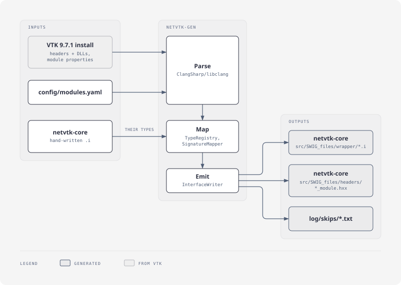

# netvtk-generator

Generates the SWIG interface files for [netvtk-core](../netvtk-core): one `.i` per VTK module, plus the value-type structs and native thunks.

| Folder | Role |
|---|---|
| netvtk-generator | reads VTK's install, writes netvtk-core's `src/SWIG_files/{wrapper,headers}`; runs on VTK upgrades and generator changes |
| netvtk-core | commits that output (declarations only, no VTK doc text) and builds without this folder |

Status:
- **`generate`:** writes 25 VTK modules in five native libraries (Common, Filters, IO, Rendering, Interaction), about 2,450 types, and RenderingOpenGL2's Windows render windows in a sixth (NetVtkWin32, Windows only); netvtk-core builds them and its tests pass on win-x64, win-x86, linux-x64 and osx-arm64.
- **`docs`:** VTK's doc comments as NetVtk's XML documentation (IntelliSense), for netvtk-core's `build.py docs`.

## Architecture

<picture>
  <source media="(prefers-color-scheme: dark)" srcset="assets/readme-architecture-dark.svg">
  
</picture>

| Pass | Does |
|---|---|
| Parse | one libclang translation unit per VTK module, function bodies included; the module's headers and dependencies from VTK's install (`share/vtk`); VTK's wrapping hints as annotations (size hints, new instances, exclusions); members checked to link (VTK's DLL export tables) |
| Map | only wrapped or typemapped types (generated modules plus netvtk-core's hand-written `.i`); VTK objects as proxies, numbers by `ref`, sized pointers as arrays; every skip logged with a reason |
| Emit | `.i` (imports base modules first, typemap macros, enums, companion include, template instances, classes), `_module.hxx`, the value-type structs (`*.g.cs`), `modules.json`, `platforms.json`, `classes.json`; deterministic |

## Commands

```bash
# writes netvtk-core's src/SWIG_files/{wrapper,headers,modules.json,platforms.json,classes.json} for config/modules.yaml;
# --check only compares
dotnet run --project src/NetVtk.Generator -c Release -- generate --vtk <VTK install prefix> --core ../netvtk-core

# unit and golden tests (no VTK needed); NETVTK_UPDATE_GOLDEN=1 rewrites the expected files
dotnet test NetVtk.Generator.slnx -c Release
```

CI (`../.github/workflows/generator.yml`) runs the same tests on Windows, Linux and macOS.

## Config

`config/modules.yaml` (hand-edited): the native libraries and their VTK modules, `platforms` (libraries of one platform's classes), `exclude_headers`; per module `vtk_module` and `headers` (a module of another's headers), `classes`, `exclude_classes`, `exclude_methods`, `exclude_namespaces`, `prelude`, `value_types`, `directors`.

No code or lists from ActiViz or other VTK bindings are copied.

License: MIT, see `LICENSE`.
